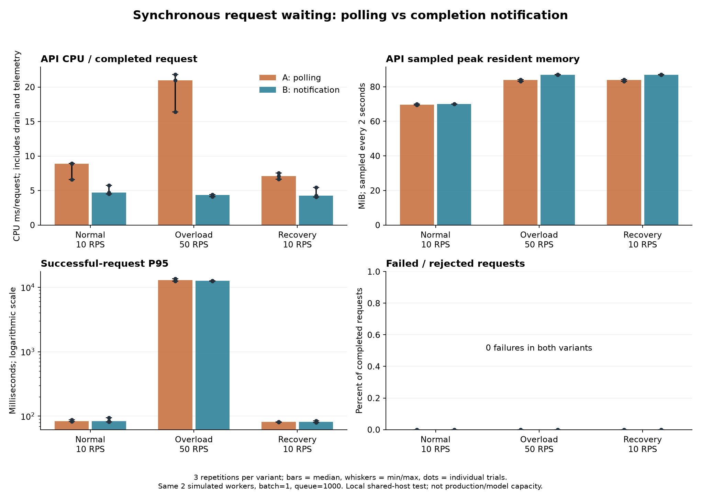
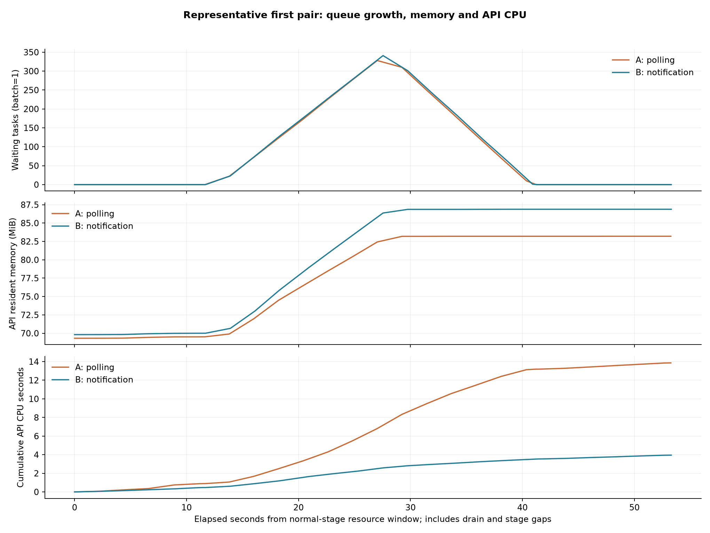
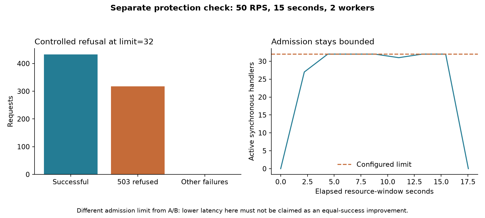

# Completion notification A/B results

Verified November 1, 2026 (America/Chicago). The API changes are local working-tree edits; no production deployment or git push was performed.

## Outcome

Replacing 1 ms task-state polling with completion notification reduced measured API CPU time per completed request by 79.3% during overload. It did not materially change worker throughput or establish a meaningful P95 improvement. Sampled peak API RSS increased by approximately 3.08 MiB.

## Equal-load comparison

Three trials per variant, alternating A/B, B/A, A/B. Every trial used two simulated gRPC workers, one task per batch, three outstanding batches per proxy, admission queue 1000, and 512 preallocated k6 clients. Candidate synchronous admission was 1024, above observed concurrency; it did not cause rejections in the comparison. Both variants had identical normal, overload, and recovery arrival rates.

Values below are medians across the three trials. Overload is 50 requests/second for 15 seconds, including response draining in the resource and execution windows.

| Measurement | A: polling | B: notification |
| --- | ---: | ---: |
| API CPU / completed request | 20.96 ms | 4.34 ms |
| API CPU time in overload resource window | 15.74 seconds | 3.26 seconds |
| Sampled peak API RSS | 83.82 MiB | 86.90 MiB |
| Successful-request P95 | 12,867 ms | 12,571.5 ms |
| Successful completions/second, including drain | 26.34 | 26.60 |
| Normal-load P95 at 10 RPS | 84 ms | 84 ms |
| Recovery P95 at 10 RPS | 82 ms | 82 ms |
| Maximum sampled API threads across overload trials | 22 | 22 |
| Failed requests in comparison stages | 0 | 0 |

All stages delivered their requested load without dropped iterations or invalid result payloads. Overload trial successes totaled 2251 for A and 2252 for B. Differences of one request reflect constant-arrival-rate boundary timing.

Overload P95 ranges were 12,351.95–13,502 ms for A and 12,466.5–12,628 ms for B. The median difference is about 2.3%, and ranges overlap. With three short local trials, this is not evidence of a general tail-latency improvement. The main demonstrated gain is lower API waiting overhead. Worker execution capacity remains the bottleneck.

Bars show medians, whiskers show min/max, and points show individual trials. CPU includes telemetry, idle checks, and drain; it is normalized by completed requests. Memory peak is sampled every two seconds, not an exact high-water measurement.

The representative first pair shows similar queue growth and draining, with lower API CPU accumulation in the notification variant. The figure intentionally includes the higher memory use.

## Separate admission protection check

With the candidate limit reduced to 32 and the same 50 RPS overload, 751 requests were delivered: 433 succeeded and 318 were refused with HTTP 503. No other errors occurred. Sampled active synchronous handlers stayed at or below 32. This verifies controlled refusal; the successful P95 of 1193 ms must not be counted as an equal-success latency improvement.

A separate real-socket check opened and closed 80 connections. The HTTP cancellation counter increased by 20; waiting queues and admitted handlers were empty at the first successful post-close observation, approximately 0.168 seconds after close initiation. This is an observed cleanup bound including sampling overhead, not an exact cancellation-latency percentile. Active computation is not forcibly interrupted.

## Regression verification

The final working-tree suite passed all 143 tests, including the 13 PostgreSQL integration tests against a disposable PostgreSQL 16 database. No database tests were skipped in that run. Benchmark helpers passed ten Python tests and three Node tests.

Regression coverage includes thread-safe completion, completion-before-registration, late-result protection, timeout/cancelled waiter removal, pre-body admission and slot release, actual ASGI request cancellation, gRPC/local queue cleanup, cancelled latency buffers after strategy changes, and durable SQL job fencing/recovery.

## Code locations

- `system/task.py`: loop-owned completion futures and worker-thread notification.
- `system/sync_requests.py`: process admission and completion/deadline/disconnect waiting.
- `system/api_server.py`: integration for /predict and /text/tasks.
- `system/queue.py`, `system/scheduler.py`, `system/grpc_worker_pool.py`, `system/worker.py`: abandoned waiting-work cleanup.
- `system/config.py`, `system/metrics.py`: MAX_SYNC_REQUESTS and active/refusal/cancellation metrics.
- `tests/test_sync_requests.py`: new regressions.
- `experiments/k6/compare_waiting.py`, `plot_waiting.py`: snapshot-based comparison and reproducible PNG/PDF figures.

## Provenance and limits

The pre-change baseline contains the previous backpressure implementation and existing text v1.2.3 defaults; it is not historical committed HEAD. Runtime SHA-256 manifests, immutable image IDs, per-trial JSON, telemetry, resource samples, logs, comparison.csv and aggregate.json are retained in `experiments/k6/results/completion-ab-20261101/` (generated artifacts, ignored by git). Figure copies are stored under docs/figures.

- Baseline snapshot: `ddd9d305d5ea2895deeae4596bf7d74a5ad5e290bc38e439dbc8dcbfe4578f8e`.
- Candidate snapshot: `d8e08eaa548c0f8d3f0c038684c66d498613638240a43532f87870529b9e4796`.

These are short simulation tests with generator and services sharing one local host. They do not establish production maximum request capacity, real audio/model latency, or 15–30 minute sustained-overload stability. Reduced API CPU offers more headroom; it is not evidence that model throughput increased by 79%.

Obsolete source build contexts and the dedicated polling image were removed after comparison at the user's request. Historical measurements and source manifests remain; the original baseline source snapshot is no longer stored locally. The current runtime is the sole platform version used by subsequent stress tests.
