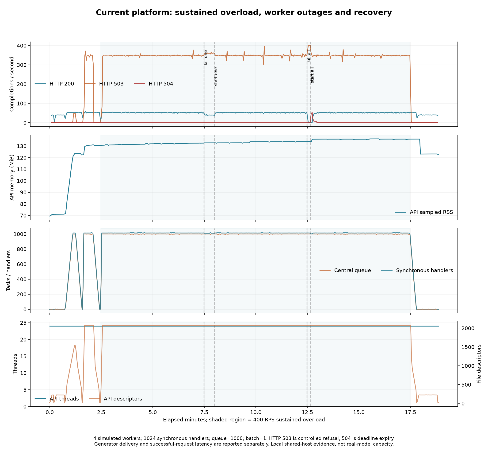

# Current-runtime sustained-overload results

Verified November 1, 2026 (America/Chicago). Only the updated completion-notification runtime was used. Tests ran in an isolated local Docker Compose project; production was not deployed, stopped, or modified.

## Outcome

The platform remained responsive through 15 minutes of deliberate overload and both worker outages. Functional stability and recovery checks passed. This does not mean the overload workload met the request latency or success-rate SLO.

Four simulated workers delivered approximately 51 successful completions/second over the soak execution window, including outage and response drain time. Offered traffic was 400 requests/second; most requests were refused to protect bounded capacity.

| Sustained 400 RPS, 900 seconds | Requests |
| --- | ---: |
| Sent and completed | 360,000 |
| Successful HTTP 200 | 46,716 |
| Controlled HTTP 503 refusal | 312,919 |
| Original-deadline HTTP 504 | 365 |
| HTTP 500 / unexpected service errors | 0 |
| Client transport failures | 0 |
| Generator dropped iterations | 0 |
| Invalid result bodies | 0 |

Successful-request P95 during overload was 21,172.75 ms. Reporting this alongside the success/refusal counts is essential: the platform did not provide 400 successful inferences/second or low-latency service at that offered load.

After overload, all 2,401 requests in the 40 RPS, 60-second recovery phase succeeded, with P95 81 ms and no refusals or timeouts. Queues, active RPCs, and synchronous handlers were first observed all-zero approximately 20.70 seconds after the estimated end of offered soak traffic. This is a sampled upper-bound observation including phase gaps, not an exact drain timer.

## Faults

- One worker was killed at observed-load +300 seconds and restarted at +330.
- All four workers were killed at +600 and restarted at +610.
- HTTP 504 increases were observed between approximately +612.22 and +627.53 seconds, concentrated in the all-worker outage/recovery window.
- The restarted single worker was first observed READY approximately 3.26 seconds after the restart command returned; all four were first observed READY approximately 7.13 seconds after restart returned. These are sampled routing-state observations, not exact detection times or first successful model-result latencies.
- A real-socket disconnect check cancelled 56 waiting tasks. Waiting work and handler counts were empty at a post-close observation approximately 0.179 seconds after closure began.

The original request budget was preserved. When every worker is absent and backlog consumes the remaining budget, a deadline failure remains possible. Recovery probe intervals and queueing budgets deserve further tuning; this test does not justify a promise that all accepted requests survive arbitrary outages.

## Resources

| API resource during soak | Observation |
| --- | ---: |
| Sampled peak process RSS | 136.21 MiB |
| Early steady-window median RSS | 132.08 MiB |
| Late steady-window median RSS | 136.04 MiB |
| Fitted steady-window RSS slope | +0.404 MiB/minute |
| Thread count range | 24–24 |
| Sampled maximum file descriptors | 2,071 |
| Post-recovery file descriptors | 21 |
| Post-recovery process RSS | 122.81 MiB |
| Sampled peak generator RSS | 824.30 MiB |

Memory grew slowly under sustained load, then declined to 122.81 MiB in recovery, close to the 122.38 MiB post-drain level after the earlier 100 RPS ramp. The present evidence does not establish a persistent leak or prove leak freedom. Repeat load/recovery cycles with allocation profiling before drawing a stronger conclusion.

File-descriptor counts include keep-alive client connections. MAX_SYNC_REQUESTS bounds admitted handlers, not all TCP connections. The return to 21 descriptors and zero waiting work is important recovery evidence.

Shading marks the sustained 400 RPS phase. Dashed lines mark actual fault command requests. Outcomes are completion rates from sampled API counters, not the offered arrival-rate curve. Raw request delivery is verified separately by k6.

## Configuration and evidence

- Four simulation workers, nominal 72 ms single-task batches.
- Three outstanding batches per proxy; central queue 1000; MAX_SYNC_REQUESTS=1024.
- 2048 preallocated k6 clients; all requested load was delivered without drops.
- 30-second ramps at 40, 100 and 400 RPS preceded the soak. The generator and services shared an 18 GiB local host.
- Runtime snapshot SHA-256: `d8e08eaa548c0f8d3f0c038684c66d498613638240a43532f87870529b9e4796`.

Exact runtime and harness source, hashes, immutable image ID, k6 version, stage summaries, sampled metrics/resources, generator measurements, fault commands, logs, assessment, and exported PNG/PDF are retained under `experiments/k6/results/stress-current-20261101/` (generated artifacts ignored by git). `stress-summary.csv` is also retained as a compact data artifact.

Historical raw results and figures remain. Obsolete A/B build source contexts, the old temporary baseline source copy, the dedicated old polling image, and an unused preliminary candidate image were deleted. No user screenshots, model code, deployed containers, or dependency images were removed.

This tests scheduling and HTTP stability with synthetic computation. It does not test real audio/model quality, SQL end-to-end job load, GPU capacity, ZooKeeper session recovery, or API-process restart durability.
